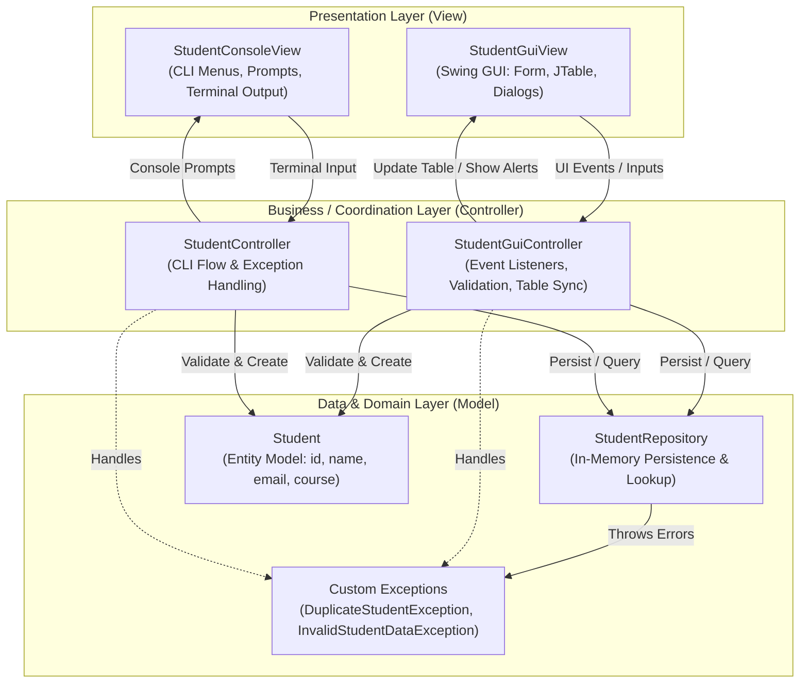
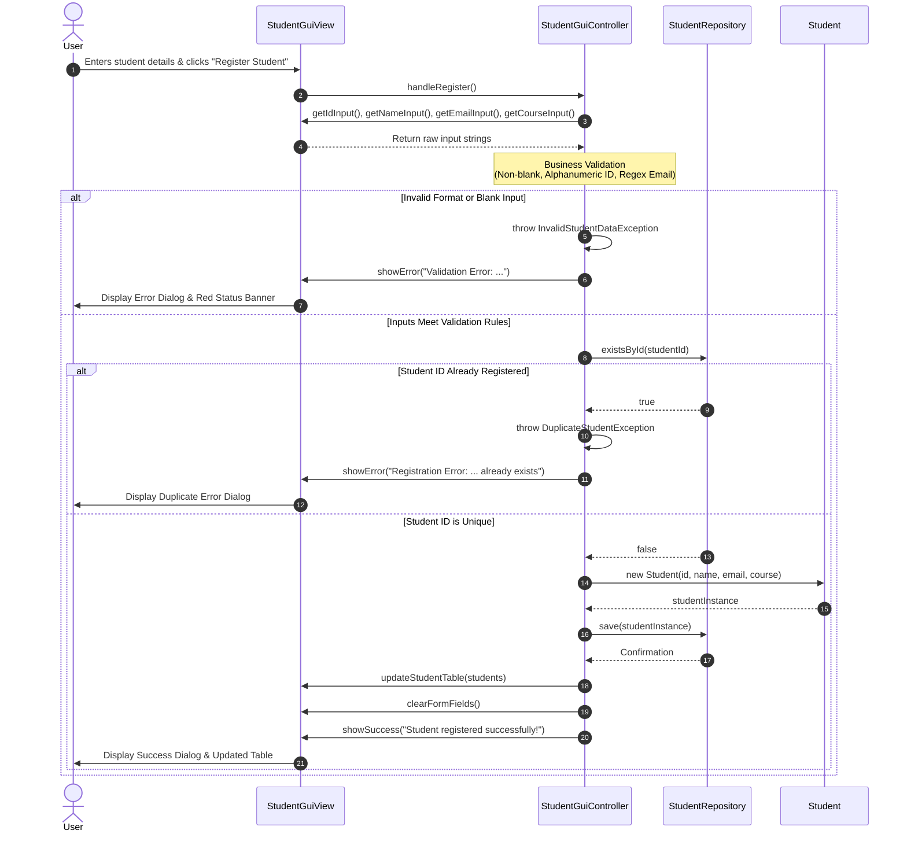

# Student Registration System (MVC)

A Java desktop application demonstrating the **Model-View-Controller (MVC)** architectural pattern through a clean, robust **"Register Student"** workflow with a modern **Graphical User Interface (Swing GUI)**, optional **Console interface**, and comprehensive error handling.

---

## 📑 Table of Contents
- [Architecture Overview](#architecture-overview)
- [Architecture Diagrams (Mermaid.js)](#architecture-diagrams-mermaidjs)
  - [Layered Architecture View](#1-layered-architecture-view)
  - [UML Sequence Diagram (Registration Flow)](#2-uml-sequence-diagram-registration-flow)
- [Project Structure](#project-structure)
- [Identified Error Scenarios & System Response](#identified-error-scenarios--system-response)
- [Getting Started in IntelliJ IDEA](#getting-started-in-intellij-idea)
- [Running the Application](#running-the-application)
- [Automated Testing](#automated-testing)

---

## Architecture Overview

The system strictly adheres to the **Model-View-Controller (MVC)** pattern to ensure separation of concerns, testability, and UI-interchangeability:

1. **Model Layer (`com.studentapp.model`)**:
   - Encapsulates student data (`Student`) and in-memory persistence logic (`StudentRepository`).
   - Defines domain-specific exceptions (`DuplicateStudentException`, `InvalidStudentDataException`).
   - Completely decoupled from UI frameworks (Swing or Console).

2. **View Layer (`com.studentapp.view`)**:
   - **`StudentGuiView` (Swing GUI)**: Modern desktop window containing registration form, live search bar, real-time data table, and status alerts.
   - **`StudentConsoleView` (CLI)**: Terminal-based menu for headless or text-only execution.
   - Responsible strictly for presenting data and capturing raw user actions.

3. **Controller Layer (`com.studentapp.controller`)**:
   - **`StudentGuiController` & `StudentController`**: Intermediary orchestrators.
   - Processes user actions triggered in the view, enforces business validation rules, queries/updates the model, catches domain exceptions, and updates the view with error dialogs or success notifications.

---

## Architecture Diagrams (Mermaid.js)

### 1. Layered Architecture View



---

### 2. UML Sequence Diagram (Registration Flow)



---

## Project Structure

```
StudentApp/
├── pom.xml                               # Maven project configuration (Java 17+)
├── .gitignore                            # Standard git exclusions for Java/IntelliJ
├── README.md                             # Project documentation & diagrams
└── src/
    ├── main/
    │   └── java/
    │       └── com/
    │           └── studentapp/
    │               ├── Main.java                          # App Entry (launches GUI)
    │               ├── controller/
    │               │   ├── StudentGuiController.java      # Swing GUI Controller
    │               │   └── StudentController.java         # Console Controller
    │               ├── model/
    │               │   ├── Student.java                   # Domain entity
    │               │   ├── StudentRepository.java         # In-memory data store
    │               │   └── exception/
    │               │       ├── DuplicateStudentException.java
    │               │       └── InvalidStudentDataException.java
    │               └── view/
    │                   ├── StudentGuiView.java            # Modern Swing GUI View
    │                   └── StudentConsoleView.java        # CLI View
    └── test/
        └── java/
            └── com/
                └── studentapp/
                    └── StudentRegistrationTest.java       # Automated unit test suite
```

---

## Identified Error Scenarios & System Response

To ensure system reliability, the registration workflow enforces robust defensive programming:

| Scenario | Trigger Condition | System Response & Exception | User-Facing Output |
| :--- | :--- | :--- | :--- |
| **Duplicate Student ID** | User enters an ID that matches an existing record in the repository (case-insensitive). | `DuplicateStudentException` thrown by business logic. Caught by Controller. | **Dialog & Status**: `[Registration Error] Student ID '<ID>' is already registered in the system.` |
| **Blank / Missing Fields** | User submits whitespace or empty input for ID, Name, Email, or Course. | `InvalidStudentDataException` thrown. Caught by Controller. | **Dialog & Status**: `[Validation Error] <Field> cannot be blank.` |
| **Invalid Email Format** | Email fails standard RFC pattern (e.g. missing `@` or `.domain`). | `InvalidStudentDataException` thrown. Caught by Controller. | **Dialog & Status**: `[Validation Error] Invalid email address format. Example: student@university.edu` |
| **Invalid ID Format** | ID contains spaces/symbols or is outside 2–15 alphanumeric characters. | `InvalidStudentDataException` thrown. Caught by Controller. | **Dialog & Status**: `[Validation Error] Invalid Student ID. Must be 2-15 alphanumeric characters.` |

**Key Design Choice**: Exceptions do **not** crash the application. The Controller catches domain exceptions gracefully and delegates user feedback to the View through non-fatal modal alerts and status cues.

---

## Getting Started in IntelliJ IDEA

1. **Open IntelliJ IDEA**:
   - Choose **File** > **Open...**
   - Select the `StudentApp` folder and click **OK**.
2. **Import as Maven Project**:
   - IntelliJ IDEA automatically detects `pom.xml`.
   - If prompted, click **Trust Project** and select **Load Maven Project**.
3. **Verify Project SDK**:
   - Go to **File** > **Project Structure** > **Project**.
   - Ensure the SDK is set to **Java 17** or higher.
4. **Run the Application**:
   - Navigate to `src/main/java/com/studentapp/Main.java`.
   - Right-click `Main.java` and select **Run 'Main.main()'**.
   - The desktop GUI window will appear immediately.

---

## Running the Application

### 1. Graphical User Interface (GUI) - Default
Compile and run directly from the command line:

```powershell
# Compile all source files
javac -d target/classes src/main/java/com/studentapp/model/exception/*.java src/main/java/com/studentapp/model/*.java src/main/java/com/studentapp/view/*.java src/main/java/com/studentapp/controller/*.java src/main/java/com/studentapp/Main.java

# Launch the desktop GUI
java -cp target/classes com.studentapp.Main
```

### 2. Console Interface (CLI) Mode
If you want to run in terminal mode without the GUI, pass `--console`:

```powershell
java -cp target/classes com.studentapp.Main --console
```

---

## Automated Testing

Run the included verification test suite to validate success and error scenarios:

```powershell
javac -d target/classes -cp target/classes src/test/java/com/studentapp/StudentRegistrationTest.java
java -ea -cp target/classes com.studentapp.StudentRegistrationTest
```
