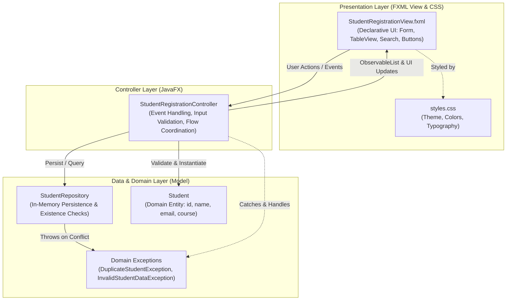
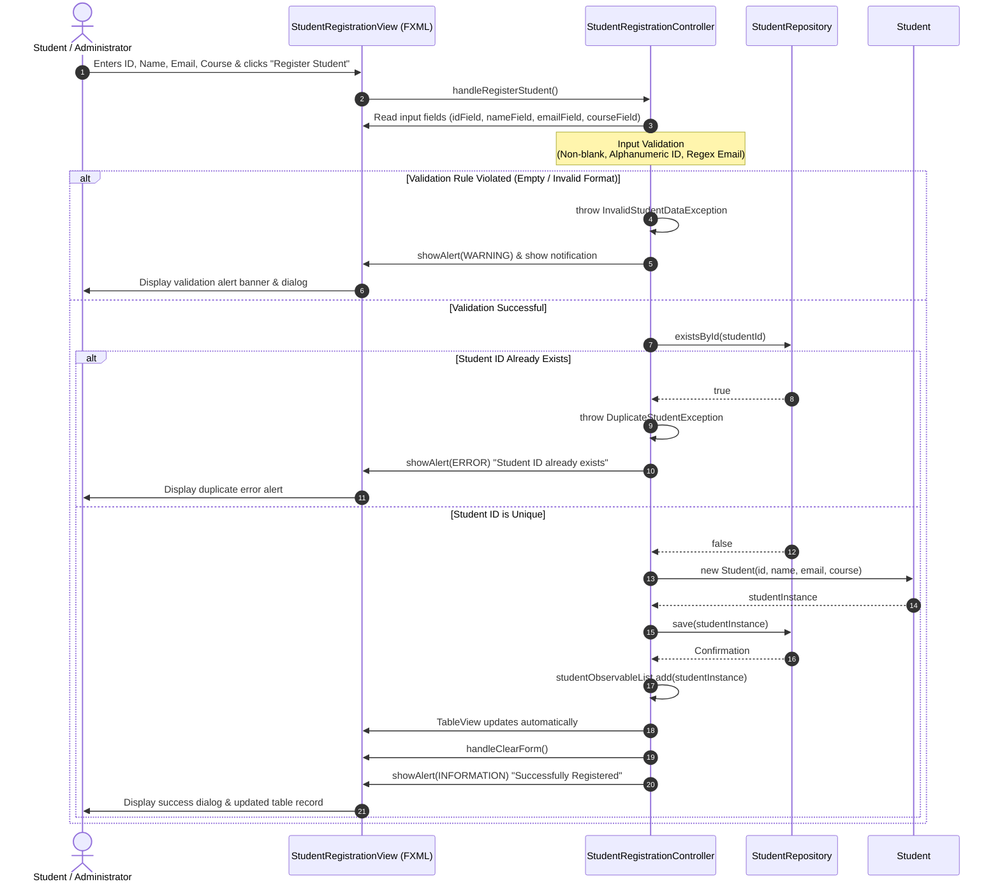

# ICT161 - Student Registration System (JavaFX & FXML)

**Course**: ICT161  
**Instructor**: Mr. Nyirenda  
**Student Name**: Achizima Marvelous Mpashi  
**Student ID**: 202511543  
**Program**: Bachelor of Science in Data Science  

---

## 📑 Table of Contents
- [Project Overview](#project-overview)
- [MVC Architecture in JavaFX](#mvc-architecture-in-javafx)
- [Architecture & Design Diagrams (Mermaid.js)](#architecture--design-diagrams-mermaidjs)
  - [1. Layered Architecture View](#1-layered-architecture-view)
  - [2. UML Sequence Diagram (Register Student Flow)](#2-uml-sequence-diagram-register-student-flow)
- [Project Directory Structure](#project-directory-structure)
- [Identified Error Scenarios & System Response](#identified-error-scenarios--system-response)
- [IntelliJ IDEA Setup & Execution Guide](#intellij-idea-setup--execution-guide)
- [Automated Verification Tests](#automated-verification-tests)
- [3-Minute Presentation Script](#3-minute-presentation-script)

---

## Project Overview

This project is a solo programming submission for **ICT161** taught by **Mr. Nyirenda**. It implements the **"Register Student"** feature using **Java**, **JavaFX**, and **FXML**, strictly structured under the **Model-View-Controller (MVC)** architectural design pattern.

The application allows registration of students with validation rules, prevents duplicate entries via custom domain exceptions, displays registered records in a dynamic `TableView`, and provides search and filter capabilities.

---

## MVC Architecture in JavaFX

1. **Model Layer (`com.studentapp.model`)**:
   - `Student`: Domain entity containing properties (`id`, `name`, `email`, `course`) and JavaBean accessors.
   - `StudentRepository`: Manages data persistence and query operations in an in-memory data store.
   - `DuplicateStudentException` & `InvalidStudentDataException`: Custom exceptions encapsulating business rule violations.
   - Completely independent from JavaFX UI components.

2. **View Layer (`resources/com/studentapp/view` & `css`)**:
   - `StudentRegistrationView.fxml`: Declarative UI layout built with FXML defining the input form (`GridPane`), interactive table (`TableView`), action buttons, search toolbar, and status panels.
   - `styles.css`: Custom CSS styling for visual appeal, highlighting active states, badges, and alerts.

3. **Controller Layer (`com.studentapp.controller`)**:
   - `StudentRegistrationController`: Bridges the FXML View and the Model.
   - Handles UI action events (`@FXML handleRegisterStudent`, `@FXML handleSearchStudent`, `@FXML handleClearForm`).
   - Executes validation logic, queries the repository, catches custom domain exceptions, and renders user feedback via modal dialogs (`Alert`) and in-window status banners.

---

## Architecture & Design Diagrams (Mermaid.js)

### 1. Layered Architecture View



---

### 2. UML Sequence Diagram (Register Student Flow)



---

## Project Directory Structure

```
StudentApp/
├── pom.xml                                       # Maven configuration with JavaFX dependencies
├── .gitignore                                    # Git exclusion rules for Java & IntelliJ
├── README.md                                     # Course & project documentation
└── src/
    ├── main/
    │   ├── java/
    │   │   └── com/
    │   │       └── studentapp/
    │   │           ├── Main.java                 # Standard JVM entry point launcher
    │   │           ├── StudentApp.java           # JavaFX Application class (loads FXML)
    │   │           ├── controller/
    │   │           │   └── StudentRegistrationController.java # FXML Controller
    │   │           └── model/
    │   │               ├── Student.java          # Domain entity
    │   │               ├── StudentRepository.java# In-memory storage & query
    │   │               └── exception/
    │   │                   ├── DuplicateStudentException.java
    │   │                   └── InvalidStudentDataException.java
    │   └── resources/
    │       └── com/
    │           └── studentapp/
    │               ├── css/
    │               │   └── styles.css            # Custom JavaFX styling
    │               └── view/
    │                   └── StudentRegistrationView.fxml # JavaFX FXML layout
    └── test/
        └── java/
            └── com/
                └── studentapp/
                    └── StudentRegistrationTest.java # Automated verification tests
```

---

## Identified Error Scenarios & System Response

| Error Scenario | Trigger Condition | System Response (Exception) | User-Facing Feedback |
| :--- | :--- | :--- | :--- |
| **Duplicate Student ID** | User attempts to register an ID that already exists in `StudentRepository` (e.g., trying to register `202511543` twice). | `DuplicateStudentException` is thrown. Caught gracefully by `StudentRegistrationController`. | **Error Modal & Banner**: *"Registration Failed: Student ID '202511543' already exists in the system."* |
| **Missing / Blank Fields** | User leaves Student ID, Name, Email, or Course blank or whitespace-only. | `InvalidStudentDataException` is thrown. Caught by Controller. | **Warning Modal & Banner**: *"[Field] cannot be blank."* |
| **Invalid Email Format** | Email fails RFC regex pattern (e.g., missing `@` or `.domain`). | `InvalidStudentDataException` is thrown. Caught by Controller. | **Warning Modal & Banner**: *"Invalid email format. Expected format: student@university.edu"* |
| **Invalid Student ID Format** | ID contains spaces, symbols, or is not 2–15 alphanumeric characters. | `InvalidStudentDataException` is thrown. Caught by Controller. | **Warning Modal & Banner**: *"Student ID must be 2 to 15 alphanumeric characters."* |

> **Design Choice**: The application will **never crash** upon input error. The Controller catches domain exceptions and routes informative feedback directly to the user through non-blocking alerts.

---

## IntelliJ IDEA Setup & Execution Guide

### Step 1: Open the Project in IntelliJ IDEA
1. Open **IntelliJ IDEA**.
2. Click **File** > **Open...**
3. Select the folder: `C:\Users\Achiz\Desktop\StudentApp` and click **OK**.
4. If asked, click **Trust Project**.
5. IntelliJ IDEA will automatically recognize the **`pom.xml`** file and download the required JavaFX 21 libraries via Maven.

### Step 2: Configure Project SDK
1. Go to **File** > **Project Structure** > **Project**.
2. Ensure the **SDK** is set to **Java 17** or higher (e.g. Java 17, 21, or 25).
3. Click **Apply** and **OK**.

### Step 3: Run the Application
1. In the Project Explorer on the left, navigate to:
   ```
   src/main/java/com/studentapp/Main.java
   ```
2. **Right-click `Main.java`** and select **Run 'Main.main()'** (or press `Ctrl + Shift + F10`).
3. The JavaFX desktop window will launch on your screen.

> **Why `Main.java`?**  
> Running `Main.java` (which invokes `Application.launch(StudentApp.class, args)`) avoids the common JavaFX module runtime errors encountered when launching an `Application` subclass directly.

---

## Automated Verification Tests

The test suite validates successful registration and all identified error scenarios:

```bash
# Can be run directly inside IntelliJ IDEA by right-clicking:
src/test/java/com/studentapp/StudentRegistrationTest.java -> Run 'StudentRegistrationTest.main()'
```

**Test Output:**
```text
Running ICT161 Student Registration automated tests...

[PASS] testSuccessfulRegistration (Registered Achizima Marvelous Mpashi)
[PASS] testDuplicateStudentError: Registration failed: Student with ID '202511543' already exists in the system.
[PASS] testInvalidEmailError: Invalid email format. Expected format: student@university.edu
[PASS] testBlankFieldsError: Student ID cannot be blank.

All tests passed successfully!
```

---

## 3-Minute Presentation Script (245 Words)

> *"Good day, Mr. Nyirenda and colleagues. My name is **Achizima Marvelous Mpashi**, student number **202511543**, enrolled in the **Data Science** program. Today, I am presenting my practical programming assignment for **ICT161**: the **Student Registration System** built in Java using **JavaFX**, **FXML**, and the **Model-View-Controller (MVC)** architectural pattern.*
>
> *Our architecture cleanly decouples the system into three layers:*
> - *First, the **Model layer**, comprising the `Student` entity, custom exceptions, and an in-memory `StudentRepository` that guarantees data integrity and persistence.*
> - *Second, the **View layer**, designed using **FXML** (`StudentRegistrationView.fxml`) and styled with CSS. It presents an intuitive registration form, an interactive `TableView`, and real-time status banners.*
> - *Third, the **Controller layer**, implemented in `StudentRegistrationController`, which links user interactions from the FXML view with the underlying Model.*
>
> *For our required error handling mechanism, the Controller enforces strict validation rules:*
> - *If a user enters blank fields, an invalid email, or invalid ID format, the system throws an `InvalidStudentDataException`.*
> - *If an ID already exists, such as re-registering student ID `202511543`, the repository rejects the operation with a `DuplicateStudentException`.*
>
> *Crucially, these exceptions never crash the application. The Controller catches them, displays user-friendly alert dialogs, and allows the user to continue seamlessly.*
>
> *In conclusion, this project demonstrates clean separation of concerns, modern JavaFX UI development, and robust defensive programming.*
>
> *Thank you, Mr. Nyirenda!"*
